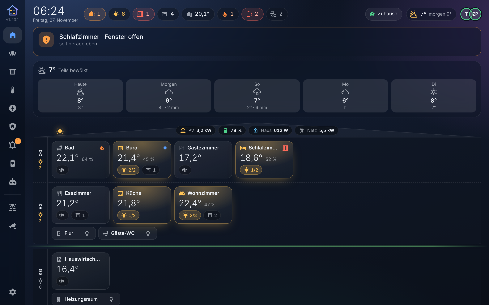
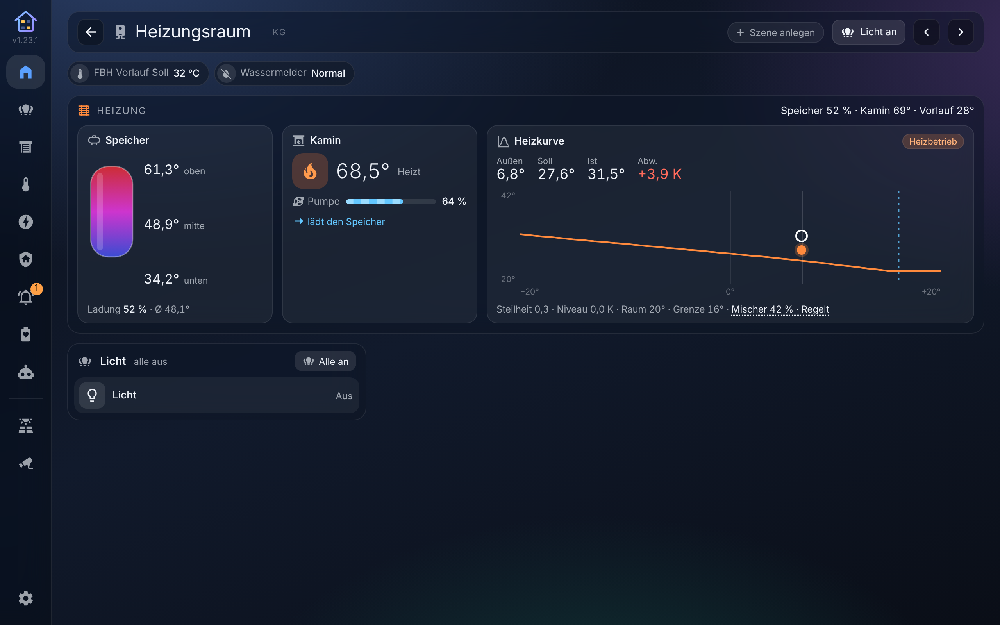
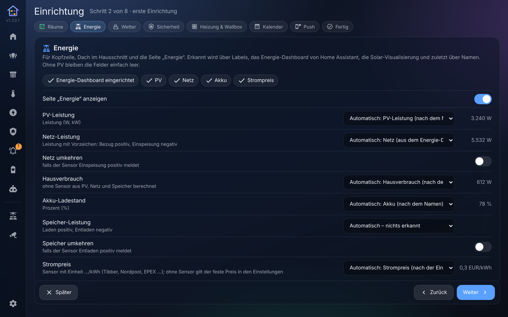

# Haus Visualisierung 2.0.2

Ein eigenes Panel für Home Assistant, das das ganze Haus auf einen Blick zeigt: Räume, Licht, Rollos, Klima,
Energie, Sicherheit und Alarme – mit eigenem Design, Alarmmanager und Hausmodus. Es baut sich wie eine
Dashboard-Strategy selbst aus Etagen, Bereichen und Geräten auf. Ein **Einrichtungsassistent** zeigt beim ersten
Öffnen, was erkannt wurde, und fragt nur dort nach, wo etwas fehlt. Läuft auf einem Raspberry Pi ohne Last: das
Panel nutzt nur die Zustände, die Home Assistant ohnehin an den Browser schickt.

| Übersicht | Heizung | Einrichtungsassistent |
| --- | --- | --- |
|  |  |  |

*Bilder aus der Testumgebung mit Beispieldaten.*

## Auf einen Blick

- **Baut sich selbst auf:** Etagen und Bereiche aus Home Assistant, Geräte nach Art (Licht, Rollo, Fenster, Klima …).
  Keine YAML-Karten, kein Zusammenklicken von Dashboards.
- **Erkennt, statt zu fragen:** Energie aus dem Energie-Dashboard von Home Assistant, Wallboxen über ihre Integration,
  Klingeln über die Geräteklasse, Müllkalender über die Integration – und was nicht passt, ordnest du mit einem
  **Label** in Home Assistant zu (siehe unten).
- **Für den Alltag:** Alarmmanager mit Push und Eskalation, Hausmodus (Zuhause, Nacht, Abwesend, Urlaub),
  Gute-Nacht-Check, Wetterwarnungen, Müllabfuhr, Familienkalender, Wartungsplaner, Szenen je Raum.
- **An der Wand:** Wandpanel-Modus mit Bildschirmschoner und eigene Wanddisplays (ESP32-S3 mit ESPHome), im Panel
  eingerichtet und geflasht.
- **Oberfläche auf Deutsch.**

## Installation

### Über HACS

1. HACS → ⋮ (oben rechts) → **Benutzerdefinierte Repositories** → `https://github.com/T-abr/ha-haus-visualisierung`,
   Typ **Integration** → Hinzufügen.
2. „Haus Visualisierung“ suchen, **Herunterladen**, Home Assistant neu starten.
3. Einstellungen → Geräte & Dienste → Integration hinzufügen → „Haus Visualisierung“.

Updates kommen danach über HACS.

### Von Hand

1. ZIP `haus_visualisierung_vX.Y.Z.zip` aus den [Releases](https://github.com/T-abr/ha-haus-visualisierung/releases)
   laden und entpacken.
2. `custom_components/haus_visualisierung` nach `/config/custom_components/` kopieren.
3. Home Assistant neu starten und die Integration hinzufügen (wie oben, Schritt 3).

Voraussetzung: Home Assistant ab 2025.1, Bereiche (und am besten Etagen) angelegt und Geräte zugeordnet.

## Erste Einrichtung

Beim ersten Öffnen des Panels startet der **Einrichtungsassistent** (nur für Administratoren). Er geht die Themen
nacheinander durch – **Räume, Energie, Wetter, Sicherheit, Heizung & Wallbox, Kalender, Push** – und zeigt bei jedem,
was automatisch erkannt wurde und woher (Label, Energie-Dashboard, Integration, Name). Zur Auswahl stehen nur
passende Entitäten (z. B. bei „PV-Leistung“ nur Sensoren in W oder kW). „Automatisch“ lässt die Erkennung
entscheiden. Gespeichert wird bei jedem Schrittwechsel; „Später“ schließt den Assistenten.

Den Assistenten startest du jederzeit erneut über **Einstellungen → Assistent**, um etwas zu ergänzen – etwa nach
einer neuen Wallbox oder einem neuen Kalender. Alles Weitere (Warnregeln, Hausmodus, Wanddisplays, Darstellung)
steht in den Einstellungen; der Reiter „Prüfen & Sichern“ meldet, was noch fehlt.

### Erkennung und Labels

Die Visualisierung sucht in dieser Reihenfolge: **Einstellungen → Label → Energie-Dashboard, Integration, Gerät,
Geräteklasse → Name**. Wo die Erkennung nicht trifft, genügt ein Label in Home Assistant (Einstellungen → Bereiche,
Labels & Zonen → Labels) an der Entität, am Gerät oder – bei Räumen – am Bereich. Home Assistant bildet die ID aus dem
Namen: aus „Haus PV“ wird `haus_pv`.

| Label | ID | Bedeutung |
| --- | --- | --- |
| Haus PV | `haus_pv` | PV-Leistung |
| Haus Netz | `haus_netz` | Netz-Leistung (Bezug positiv) |
| Haus Verbrauch | `haus_verbrauch` | Hausverbrauch |
| Haus Akku | `haus_akku` | Akku-Ladestand |
| Haus Akku Leistung | `haus_akku_leistung` | Speicher-Leistung (Laden positiv) |
| Haus Strompreis | `haus_strompreis` | Strompreis-Sensor |
| Haus Wallbox | `haus_wallbox` | Wallbox (am Gerät: alle seine Entitäten) |
| Haus Heizung | `haus_heizung` | am Bereich: Heizungsraum; an Entitäten: Baustein „Werte“ der Heizungskarte |
| Haus Speicher | `haus_speicher` | Speicherfühler (oben/mitte/unten nach Namen) |
| Haus Kamin | `haus_kamin` | Kamin-Temperatur |
| Haus Kamin Pumpe | `haus_kamin_pumpe` | Kamin-Pumpe |
| Haus Vorlauf | `haus_vorlauf` | Vorlauf-Temperatur |
| Haus Außen | `haus_aussen` | am Bereich: Außenbereich; an Sensoren: Außenfühler |
| Haus Regensensor | `haus_regensensor` | Regensensor |
| Haus Markise | `haus_markise` | Markise (Sturmwarnung) |
| Haus Klingel | `haus_klingel` | Klingel-Auslöser |
| Haus Müll | `haus_muell` | Kalender der Müllabfuhr |

Entitäten mit dem Label `no_dboard` blendet die Visualisierung aus.

## Funktionen

- **Übersicht** in vier Varianten (Hausschnitt, Cockpit, Etagen-Spalten, Aktiv-Fokus), automatisch Cockpit am
  Desktop und Aktiv-Fokus am Handy; Darstellung Kompakt oder Komfort; vier Kopfzeilen.
- **Raumseiten und Sammelseiten** (Licht, Beschattung, Klima, Sicherheit, Batterien) – Wischen zum Dimmen,
  langes Drücken für Details; auf Raumseiten Temperatur- und Feuchteverlauf der letzten 24 Stunden, auf der
  Klimaseite Haus-Durchschnitt und Außentemperatur über 24 Stunden, eine Woche, einen Monat oder ein Jahr
  sowie ein Verlauf je Raum.
- **Energie**: Energiefluss mit PV, Netz, Speicher, Wallbox und Haus, Autarkie und Eigenverbrauch jetzt und heute,
  Leistung der letzten 24 Stunden, Energie je Tag für Woche und Monat bzw. je Monat fürs Jahr; ein Tipp aufs Dach
  öffnet die Seite.
- **Heizung** im Heizungsraum, aus Bausteinen: Speicher mit Schichtung und Ladung, Kamin mit Pumpe, Heizkurve mit
  Betriebspunkt und Mischer (passt zur Integration „Heizkurve Fußbodenheizung“) und „Werte“ für beliebige Entitäten,
  z. B. einer Wärmepumpe oder Gastherme. Jeder Baustein lässt sich abschalten.
- **Wallbox** in der Einfahrt: Ladeleistung, Ladestand, Reichweite, Lademodus und Ziel (EVCC, go-e, Easee, KEBA,
  openWB, OCPP und andere – erkannt über die Integration). Die Lademodi heißen wie bei EVCC oder frei benannt.
- **Szenen je Raum**: Stimmungen wie Kino oder Essen im Panel anlegen (Lichter mit Helligkeit und Farbe, Rollos mit
  Position, Schalter; Vorlage aus dem aktuellen Zustand) und auf der Raumseite oder im Schnellzugriff mit einem Tipp
  schalten. Jede Szene ist eine Entität `scene.haus_…` im Raum – auch als Kachel am Wanddisplay und in Automationen.
- **Wetter und Beschattung**: Vorhersage für fünf Tage auf der Seite Beschattung, „morgen“ im Kopf und im
  Bildschirmschoner; Hinweise wie „Morgen 30 °C: Südrollos bis 10:30 schließen“ aus Vorhersage, Sonnenstand am
  Standort und Ausrichtung der Fenster. Geschaltet wird nur auf Tippen, mit Rückfrage.
- **Wetterwarnungen**: Unwetter vom Deutschen Wetterdienst (Integration „DWD Weather Warnings“), „Regen kommt“ bei
  offenen Fenstern und Türen (Regensensor, Wetterlage oder stündliche Vorhersage) und „Sturm“ bei ausgefahrener Markise –
  im Alarmmanager, in Kopfzeile, Schoner, am Wanddisplay und per Push; `sensor.haus_wetter`.
- **Müllabfuhr und Termine**: „Morgen: Gelbe Tonne“ in der Kopfzeile und im Bildschirmschoner, am Vorabend
  hervorgehoben, dazu Termine von heute und morgen; aus Kalendern in Home Assistant (z. B. Waste Collection Schedule).
- **Familienkalender**: Seite „Kalender“ als Monatsraster (mehrtägige Termine als Balken, gewählter Tag mit allen Terminen daneben), Farbe und Name je Kalender
  (z. B. ein iCloud-Kalender je Familienmitglied), Müllabfuhr mit Tonnenfarbe; Apple-Kalender siehe unten.
- **Wartungsplaner**: wiederkehrende Aufgaben (Filter, Rauchmelder, Kaminkehrer, Heizungswartung …) mit Intervall und
  Fälligkeit auf der Seite „Wartung“, „Erledigt“ für alle Benutzer, fällige Aufgaben als Hinweis in den Meldungen.
- **Automationen** (nur für Administratoren): alle Automationen von Home Assistant mit Bereich, Beschreibung und
  „zuletzt ausgelöst“, Suche, Schalter zum Aktivieren/Deaktivieren; neue einfache Automationen (ein Auslöser: Uhrzeit,
  Sonne oder Zustand; eine Aktion: schalten, Szene, Benachrichtigung) direkt anlegen, alles andere im Editor von Home Assistant.
- **Wanddisplays** (z. B. 4-Zoll-ESP32-S3 mit ESPHome): das Display ist ein Client der Visualisierung, Seiten und
  Kacheln stehen in Einstellungen → Wandpanel & Displays. **Einrichten ohne Handarbeit** im selben Reiter: Firmware aus dem
  Browser flashen (Chrome/Edge über HTTPS, Firmware liegt der Integration bei), WLAN per Improv, Gerät übernehmen
  und zuordnen, **Firmware-Updates über das Netz** (Update-Entität je Display). Die Inhalte kommen fertig gerechnet per Push ans Gerät (und als `sensor.haus_display_<kennung>`),
  Tipps über den Dienst `haus_visualisierung.display_tap`. Firmware: [ha-haus-display](https://github.com/T-abr/ha-haus-display),
  Schnittstelle: [DISPLAY_PROTOKOLL.md](DISPLAY_PROTOKOLL.md) (Protokoll 1; Push und Einrichten ab 1.13.0 mit Firmware 0.2.0). Neue Alarme füllen den Bildschirm rot, mit „Quittieren“ und „1 h stumm“ am Gerät (Firmware ab 0.8.0).
- **Wandpanel-Modus** je Gerät (auch per `?wandpanel=1`): Vollbild ohne Seitenleiste, Bildschirmschoner mit Uhr,
  Wetter, Hausmodus und Meldungen (Elemente, Innentemperatur, Uhrgröße und Nachtzeit einstellbar, gilt auch für die
  Wanddisplays), automatische Rückkehr zur Startseite; Klingel, Alarme und Bewegung wecken auf.
- **Fotos im Bildschirmschoner** aus Apple Fotos: geteiltes iCloud-Album mit „Öffentliche Website“, Link unter
  Einstellungen → Wandpanel & Displays (oder im Assistenten). Die Integration holt die Bilder alle 6 Stunden und
  speichert sie unter `/config/haus_visualisierung/fotos`; Querformat läuft als Vollbild mit langsamem Zoom,
  Hochformat im Rahmen vor weichgezeichnetem Hintergrund, Uhr und Infos bleiben darüber. Nachts keine Fotos.
- **Als Standard-Dashboard** (Einstellungen → Darstellung → „Beim Öffnen von Home Assistant“): Home Assistant öffnet
  statt der Übersicht die Visualisierung, für den eigenen Benutzer, für alle oder nur auf diesem Gerät.
- **Einstellungen im Panel** mit Reitern (Räume, Alarme, Meldungen, Energie, Technik, Wandpanel & Displays, Darstellung, Prüfen & Sichern) mit Sprungleiste und Sortieren per Ziehen.
- **Prüfen & Sichern**: Einrichtungs-Check (gelöschte Entitäten, Räume ohne Fühler, Rollos ohne Ausrichtung …) und
  Sicherungen der Einstellungen – automatisch vor Updates und täglich vor dem Speichern, wiederherstellen, als Datei
  herunterladen und einspielen.
- **PIN für heikle Aktionen**: Tür öffnen, Alarm aus, Abwesend/Urlaub nur mit PIN – an Wandpanels und Wanddisplays oder
  überall; die PIN bleibt in Home Assistant. Wanddisplays (Firmware ab 0.7.0) fragen sie mit einem Tastenfeld ab.
- **Eingebettete Panels** (Solar, Protect, Dashboards) mit fester Navigation und Haus-Farben; Verknüpfungen auf
  Panels, die nicht installiert sind, blendet das Menü aus.
- **Klingel-Overlay** mit Kamera, Live-Bild und Türöffner (Schalter, Taste, Schloss).
- **Zeitleiste „Was war los?“** auf der Seite Sicherheit: Türen und Schlösser, Klingeln mit Standbild, Bewegung,
  Hausmodus und Alarme der letzten 1–14 Tage, nach Tag gruppiert und filterbar. Klingel-Standbilder bleiben 7 Tage
  (`/config/haus_visualisierung/klingel`, abschaltbar unter Einstellungen → Klingel).
- **Alarmmanager**: Warnregeln (fest und eigene), Leitstelle, Quittieren, Stummschalten, Protokoll,
  Fehlalarm-Auswertung, Push-Meldungen mit Aktionsknöpfen.
- **Hausmodus** Zuhause, Nacht, Abwesend, Urlaub – Automatik nach Personen und Uhrzeit, Kopplung mit Alarmo,
  Regeln je Modus.
- **Anwesenheits-Simulation** im Urlaub: Lichter und Rollos nach dem Muster eines echten Tages der letzten Wochen,
  leicht zufällig verschoben; endet automatisch bei der Rückkehr.
- **Eskalation und Aktionen**: KNX-Telegramm, Schalter, Sirene, Durchsage (Sonos), Skript – mit Zurücksetzen.
- **Entitäten** `select.hausmodus`, `sensor.haus_alarme_aktiv`; Ereignisse `haus_visualisierung_alarm`,
  `haus_visualisierung_modus`.
- Karten `custom:haus-raum-card` und `custom:haus-hausschnitt-card` für eigene Dashboards.

## Kalender

### Apple-Kalender (iCloud) einbinden

Die Visualisierung liest Kalender-Entitäten (`calendar.*`). Für den Apple-Kalender:

1. Auf [appleid.apple.com](https://appleid.apple.com) → Anmelden und Sicherheit → App-spezifische Passwörter ein
   Passwort erzeugen (z. B. „Home Assistant“).
2. In Home Assistant: Einstellungen → Geräte & Dienste → Integration hinzufügen → „CalDAV“. URL
   `https://caldav.icloud.com`, Benutzername = Apple-ID (E-Mail), Passwort = das app-spezifische Passwort,
   SSL prüfen an. Jeder iCloud-Kalender (auch geteilte Familienkalender) wird eine eigene Entität.
3. In der Visualisierung: Einstellungen → Darstellung → Müllabfuhr und Termine, die Kalender auf „Termine“ stellen
   und je Kalender Farbe und Namen wählen. Danach erscheint im Menü die Seite „Kalender“.

Die CalDAV-Integration fragt iCloud etwa alle 15 Minuten ab; neue Termine erscheinen also mit etwas Verzögerung.

## Entwicklung

- Handbuch: Projekt-Dokument „Haus Visualisierung – Benutzerhandbuch“; Änderungen: `CHANGELOG.md`;
  Performance: `PERFORMANCE.md`.
- Tests: `pytest` (Backend in echter HA-Instanz), `python3 tests/interact.py` (Bedienung im Browser),
  `python3 tests/perf/measure.py` (Performance). Abhängigkeiten: `pip install -r tests/requirements.txt`.
  Die Browser-Prüfungen laden direkt `custom_components/haus_visualisierung/frontend/haus-visualisierung.js`
  und die Module daneben (über `tests/harness_server.py`), eine Kopie im Harness gibt es nicht.
- Nur geänderte Teile prüfen (während der Entwicklung): `python3 tests/changed.py` vergleicht mit `main`
  (inkl. nicht committeter und neuer Dateien) und führt nur die passenden Gruppen der Bedienprüfungen aus,
  dazu `pytest`, wenn Python-Code oder Frontend betroffen ist. `--zeigen` zeigt nur die Auswahl.
  Gruppen gezielt: `python3 tests/interact.py klima energie`, Übersicht: `python3 tests/interact.py --liste`.
  Welche Datei welche Gruppen auslöst, steht in `GRUPPEN_FUER` in `tests/changed.py`; gemeinsam genutzte Module,
  das Harness und neue, dort nicht eingetragene Frontend-Dateien lösen alle Gruppen aus. Die CI prüft immer alles.
- Frontend: `frontend/haus-visualisierung.js` ist nur der Einstiegspunkt; der Code steckt in ES-Modulen unter
  `frontend/modules/` (ohne Build-Schritt). Das Panel setzt sich aus `panel.js` und den Teilen `panel-*.js` zusammen.
  Die Versionsnummer des Frontends steht in `frontend/modules/version.js`.
- CI: GitHub Actions (`.github/workflows/tests.yml`) prüft bei jedem Pull Request und Push auf `main`
  die Versionen, die Backend-Tests und die Bedienprüfungen.
- Version setzen: `python3 scripts/bump_version.py patch|minor|major`, ZIP bauen: `python3 scripts/build_zip.py`.
- Release: `main` nimmt nur Pull Requests an, daher setzt der Sammel-PR die neue Version mit `bump_version.py`
  (CHANGELOG-Abschnitt „Unveröffentlicht“ → neue Version). Nach dem Merge auf GitHub → Actions → „Release“ →
  „Run workflow“: Der Workflow übernimmt die Version aus `manifest.json`, legt den Tag `v<Version>` an, baut das ZIP
  und veröffentlicht das Release mit dem CHANGELOG-Abschnitt. Ein von Hand gepushter Tag `vX.Y.Z` (muss zur Version
  passen) startet ihn ebenfalls.
